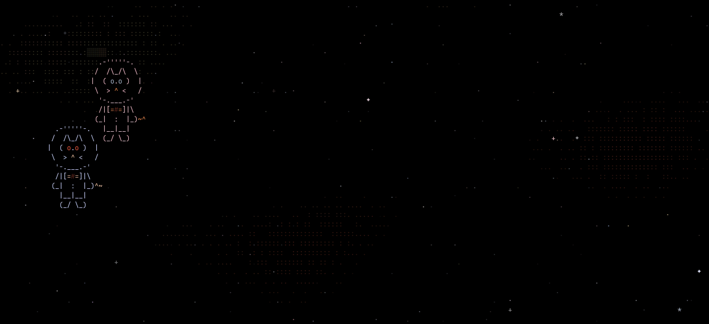

# Space Cats for Omarchy

An animated, almost-all-ASCII screensaver for [Omarchy](https://omarchy.org): astronaut cats floating
through space, getting into trouble. It replaces Omarchy's stock screensaver, follows your current
theme's colours, and spans all your monitors as one continuous scene.



## What's in it

- **Floating cats** that drift, nap, hold paws, bump into each other, and swat at anything that passes
- **Space shuttles** with a cat at the controls. Cats get knocked flying or surf behind them, and
  sometimes the engine dies and the cat has to get out and push
- **Saucers** that tow big waving banners ("FEED ME", "404 MOUSE NOT FOUND", …), beam up fish,
  abduct cats, and steal the ball from the cat in jet boots
- **Black holes** that swallow cats, balls and shooting stars, then spit them all back out
- **A pulsar** with sweeping beams and shockwaves. Every cat puts on sunglasses while it's out
- **Visitors:** a giant yarn ball, a space mouse, a cardboard box (if it fits, a cat sits),
  a satellite cat knocking parts off the edge, and the occasional cucumber
- Planets, constellations, meteor showers, warp speed, and lighting from engines, beams and stars

## Requirements

- Omarchy (tested on 4.5) with Hyprland
- Alacritty, Ghostty, Foot or Kitty as the default terminal (same as Omarchy's own screensaver)
- Python 3.8+ (Omarchy ships it; no extra packages)

## Install

```bash
git clone https://github.com/SpaceFoon/omarchy-space-cats.git
cd omarchy-space-cats
./install.sh
```

It takes over the next time the screensaver starts. To see it right away:

```bash
bash -lc 'omarchy-launch-screensaver force'
```

Update by pulling and running `./install.sh` again. Check the install with `./install.sh status`.

## Uninstall

```bash
./install.sh uninstall
```

This removes `~/.local/share/space-cats` and the block in `~/.bashrc`, and Omarchy's stock
screensaver is back.

## Preview in a terminal

Run it in any terminal window, any size. Any key quits.

```bash
python3 ~/.local/share/space-cats/space-cats.py
```

Most visitors take a minute or two to show up. To bring some forward to the first few seconds:

```bash
SPACECATS_SOON=box,moon,cuke,mouse,yarn,sat,hole,pulsar python3 ~/.local/share/space-cats/space-cats.py
```

## How it works

`space-cats.py` is a single Python file using only the standard library. Thirty times a second
it moves everything in the scene, draws it onto a grid of characters back to front, tints the
cells near light sources, and writes the frame to the terminal in one go.

Omarchy has no setting for a custom screensaver: its launcher always runs `omarchy-screensaver`.
So the installer puts `~/.local/share/space-cats/bin` first on `PATH` from `~/.bashrc`, where
Omarchy's idle timer finds a stand-in `omarchy-launch-screensaver`. That stand-in runs Omarchy's
real launcher with one change, starting Space Cats instead of the stock screensaver in each window.
If a future Omarchy changes its launcher so that swap no longer applies, you simply get the stock
screensaver again.

**Multiple monitors.** Omarchy opens one screensaver window per monitor. The first window to start
writes a start time and a random seed, and every window then simulates the identical world in
lockstep and draws only its own monitor's slice, laid out from the monitor positions Hyprland
reports. So a ship flying off one screen arrives on the next.

## Settings that still apply

How long until the screensaver starts, and when the screen locks, are Omarchy's own settings in
`~/.config/omarchy/shell.json`:

```json
"idle": { "screensaver": 150, "lock": 1050 }
```

Both are seconds of idle time; the example runs the screensaver for 15 minutes before locking.

## Regenerating the GIF

`tools/render-gif.py` renders the README animation offscreen from the simulation itself (no screen
recording), using Omarchy's JetBrains Mono font. It needs Pillow and ffmpeg, which the screensaver
itself does not.

## License

MIT
